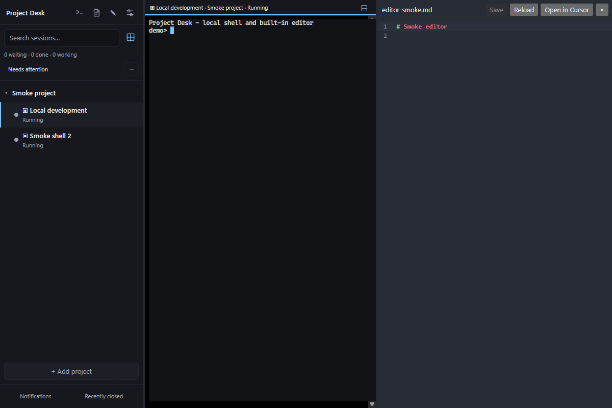

# Project Desk

A desktop app for running Claude Code, Codex, Antigravity CLI and plain shell sessions across many projects from one window. Each project lists its sessions with a live status, so you can see at a glance which agent is working, which one is done and which one is waiting for you.

**[Download for Windows, macOS and Linux](https://github.com/dugynoo/project-desk/releases/latest)** | [Get started](#get-started) | [Report a problem](https://github.com/dugynoo/project-desk/issues)

- Keep projects and agent conversations together, with status and notifications.
- Arrange terminals side by side or in a grid, and resume saved conversations.
- Make quick file edits in the built-in editor or open your preferred external editor.



*Windows desktop using an isolated demo project and shell sessions; no private agent conversations.*

### Get started

1. Install the package for your OS from the download link above.
2. Install and sign in to the agent CLI you want to use (Claude Code, Codex or Antigravity). Plain shell sessions need no agent.
3. Choose **Add project**, select a folder, then use **+** or **▾** to open a session.

The interface is available in English, Slovak and Czech. See [agent status](#agent-status) for provider-specific tracking limits.

## App behavior

It replaces the earlier Cursor extension. Your editor opens only when you ask for it.

The UI is available in English, Slovak and Czech (⚙ Settings → Language). English is the default.

Launching Project Desk again brings the existing window forward, including when minimized.
Only one instance may use a data directory at a time; development and production can run
alongside each other because they use separate identifiers and state. An OS file lock also
protects state when desktop instance discovery is unavailable (for example, Linux without
a session bus). The lock is released on exit or crash; do not delete `instance.lock` manually.
After upgrading from a version without this protection, close the older app before launching
the new version.

### CLI version checks

Settings checks the installed Claude, Codex and Antigravity CLI versions on opening;
use **Check CLI versions** to retry after changing a command or installing a CLI.
Checks run locally via `--version` in the configured shell, with an eight-second
timeout and no recurring background checks. Standard agent commands (including
quoted executable paths and startup flags) are supported. Wrappers such as `npx`
and custom shell syntax are marked as not automatically verifiable; this does not
prevent launching sessions. The check does not verify sign-in or newer releases.

## Features

- **Insert file paths:** drag files or folders from your file manager onto a running
  terminal, hold **Shift**, and release. Their full paths are pasted with quoting;
  nothing is submitted until you press Enter. Multiple files are supported. In a
  panel layout, the terminal under the pointer receives the paths. Dropping without
  Shift, onto a stopped session, or outside a terminal inserts nothing. File contents
  are not read or uploaded by Project Desk. Quoting follows the default platform shell
  (PowerShell on Windows, POSIX shells on macOS/Linux); custom shells may need adjustment.

### Projects and sessions
- Adding a project compares directory identities using the filesystem, including symlink aliases and its actual case-sensitivity rules. Distinct `Project` and `project` directories can be added separately on case-sensitive filesystems. Unavailable old paths do not block adding another project; existing saved paths are preserved.
- **Import existing conversations:** open the project's **+ ▾** menu and choose **Import existing conversation…**. Claude and Codex list saved conversation titles, IDs and file modification dates for that project. Claude uses saved custom/AI titles and Codex uses its local title index; sessions without a saved title remain labelled as untitled. Selecting a named conversation pre-fills the import name. AGY offers the last project conversation from `~/.gemini/antigravity-cli/cache/last_conversations.json`; its date describes the cache file. All three support pasting a UUID and entering a session name. Imported sessions remain stopped until you explicitly start them; close the original agent first. Already assigned conversations cannot be imported twice. No conversation text is copied or displayed.
- **Repair a missing conversation ID:** open a session's **ⓘ → Link conversation…** and choose or paste the ID actually open in that terminal. This changes tracking and future resume without restarting or switching the running agent. IDs entered manually are format-checked; the agent verifies existence when resumed. For older AGY conversations, use the ID from its resume command; the local cache is not a complete history. See [AGY resume documentation](https://www.agy.dev/docs/cli/commands/resume).
- Projects live in expandable sidebar groups. Each project has **+** for the default session, **▾** for other providers/import, and **⋯** for opening the editor, pinning or removing the project. Collapsed projects show a badge when sessions need confirmation. Project headers and sessions support Tab and Enter/Space; menus support arrow keys and Escape. Names use the available width until action buttons appear on hover or keyboard focus.
- Drag projects to reorder them. Pinned projects always stay on top.
- Drag sessions to reorder them within their project. New sessions are added at the end, and Ctrl+1–9 follow the order in the sidebar.
- Hide a session from its ⋯ menu to keep it running without taking space. The project shows **Hidden: N**; click it to show hidden sessions in place and choose **Show** to bring one back. A hidden session returns automatically when it needs your confirmation. Ctrl+1–9 skip hidden sessions, and panel layouts can still show them.
- Drag the sidebar edge to resize it.
- **Auto-hide sidebar** (button beside Settings, or the palette): the sidebar shrinks to a narrow strip with one dot per session, grouped by project: red needs you, yellow is working, green is done, grey is stopped or untracked. Hovering the strip slides the sidebar over the terminal without resizing it; it retracts when the pointer leaves, but stays while a menu, rename or drag is in progress. Clicking a dot opens that session; » keeps the sidebar open again.
- A project's **⋯** menu opens its folder in Explorer, Finder or the file manager.
- Rename a session inline by double-clicking or using **⋯ → Rename**. The same menu (also available on right-click) contains diagnostics and close/remove. Stopped sessions keep a quick restart button. Closing a terminal moves it to **Recently closed** in the fixed sidebar footer (up to 20 sessions), where it can be resumed with its conversation ID. **Notifications** is beside it, with a badge only for unread items.
- When a process exits, its terminal output stays visible with the exit code and a **Start again** button. Stopped sessions stay stopped after an app restart; terminal output itself is not saved to disk.
- **Pause** (⏸ in the terminal header or the session's **⋯** menu) stops a running Claude, Codex or AGY session and its child processes, such as MCP servers, but keeps it in the list. **Start again** resumes the same conversation. Pausing a working agent asks for confirmation, because it interrupts the current step. Shell sessions and Windows background workers cannot be paused.
- Closing the window or quitting while an agent is working or waiting for you asks for confirmation, because the app stops its terminals and interrupts the current step. System shutdown and logout on Linux do not ask. Sessions that were working when this happened (including during an update) are marked **interrupted** in the sidebar after restart until the agent works again; the conversation is resumed, but the step must be continued manually.

### Agent status
Session metadata is scanned incrementally with fixed-size buffers. Large histories may take several polling cycles to catch up; historical completion events do not produce notifications. Conversation text is not retained by the tracker. Tracking metadata for stopped or closed sessions is released during the next completed polling cycle; restarting rebuilds usage totals from the session file. Missing session files and unresolved new Codex conversations are retried with increasing delays (3, 6, 12, 24, then 30 seconds), using the existing polling cycles. A new launch resets this delay. Once found, normal status polling continues; a file created after a long idle period may take about 30 seconds plus one polling cycle to appear.

Green **Done** means the agent is ready for another prompt (including initial readiness or an interrupted turn); yellow **Working** means a turn is in progress; red **Waiting for input** means a reported approval request or question. Shells retain their neutral **Running** status.
Startup preserves status events received while launching the terminal. If no readiness event arrives within 15 seconds, the neutral **Status unavailable** label replaces **Starting**; later events still restore live tracking. Before resuming a Codex item with a missing conversation ID, Desk checks session metadata around the item's original creation time (5 seconds before to 60 seconds after), including older sessions. It saves and resumes the ID only when exactly one unclaimed, non-subagent conversation matches the project and time window. New-session discovery also requires a unique valid, non-subagent conversation. Overlapping unlinked launches in the same directory stay unlinked rather than guessing ownership; delayed discovery results are discarded after a close or restart. Ambiguous matches stay unlinked; Desk does not select whichever conversation was active most recently. On Windows, macOS and Linux, Desk also launches Codex with a SessionStart hook for that launch only (`codex -c …`); your `~/.codex/config.toml`, plugins and hook trust are not changed. When a conversation starts, resumes (including `/resume` inside a new session) or is cleared, the hook reports its ID from Desk's own Codex process, so it is linked without guessing ownership. Codex runs the hook as the first prompt starts, so a conversation picked with `/resume` is linked after its first message. The hook forwards only the conversation ID and start source. Codex trusts the hook by a hash of its declaration; if a future Codex computes it differently, the hook is skipped and the session-file discovery above still applies. On Windows, the override preserves arguments through Windows PowerShell 5.1 using TOML literal strings and an encoded hook command, with trust scoped to the project drive. This adds a short-lived process at conversation start/resume, not another background watcher. Already running Codex processes receive the hook on their next launch. The default Codex commands include `--no-daemon`, so the conversation is owned by the session's own process tree instead of Codex's shared background server; otherwise a restart or update of Desk could leave the conversation held by that server and resume would report *This conversation is open in another app*. Unchanged previous defaults are migrated; custom commands are kept as entered. Older Codex releases without this option are detected once per app run from `codex --help`, and the option is then left out of the launch.
- **Claude Code:** status comes from Claude Code hooks: *Working*, *Waiting for input*, *Done*, *Agent exited*. Permission requests report waiting immediately; failed tools return to working, and a turn-ending API error reports that attention is needed. The app starts Claude with `--settings` pointing at local hooks. Hooks only observe status and never approve or deny requests. A notification that one of Claude's background agents needs input does not change the session's own status. Your `~/.claude` settings are never modified. See the [Claude hook lifecycle](https://code.claude.com/docs/en/hooks).
- **Codex:** status comes from event types and timestamps in the Codex session file in `~/.codex/sessions`: *Working*, *Done*. Historical usage totals survive resume, but status from before the current process launch is ignored: an interrupted old turn is not proof of current work. Usage data alone does not imply completion. Until a current status arrives, startup falls back to *Status unavailable*. Current-launch snapshots do not replay old notifications. Approval waiting still cannot be detected reliably from this file.
- **Antigravity CLI:** project-local hooks report activity, completion and explicit `ask_question` / `ask_permission` tools. Automatic permission dialogs are not exposed by these hooks; token usage is not tracked. See setup below.
- **Notifications:** a system notification and an unread dot appear when an agent finishes or needs you while you are looking elsewhere.
- **Attention overview:** the sidebar counts waiting, completed and working sessions. Use **Needs attention** to filter to waiting/completed sessions; **Ctrl+Shift+A** jumps to the next one.
- **Notification center:** the **Notifications** button opens the last 100 completion/input-request events, newest first, with unread markers and relative times. Click an available session to jump to it, mark all events read, or clear read entries. History survives restarts and records only session/project labels, provider, event type, time and read state. Closed/removed sessions remain in history without being relaunched. Initial readiness and restored status snapshots do not create new completion events. Events for the session you are watching are already read; desktop notification settings do not disable this history.

### Session info
The session info dialog also shows whether the terminal process is running, whether a conversation ID is assigned, the status source and the last received status event. Diagnostic observations stay in memory and reset on each terminal start. Codex events restored from a file are labelled with their read time, not an invented event time. An assigned ID alone does not confirm that status tracking is working. Shell sessions show process information without agent tracking.

Click **ⓘ** or choose **⋯ → Session info** (also on right-click) to see the model, context size, tokens (new, from cache, output) and, for Codex, the used rate limit. The conversation ID can be copied. The numbers apply to the current conversation and restart after `/clear`.

### Keep Claude running across app restarts (experimental, Windows)

In **Settings → Agents**, enable **Keep new Claude sessions running when the app
closes**. It is off by default and applies only to newly created Claude sessions;
existing and imported conversations keep their current behavior. Requires native
Claude Code **2.1.310+** and the command `claude` or
`claude --dangerously-skip-permissions`. Custom command options are rejected
explicitly in this mode. Other providers are unchanged. If Claude does not trust
the project yet, the new session starts as an ordinary session in its own terminal
so you can accept Claude's trust prompt there; later new sessions in that project
run in the background.

Claude's background supervisor owns the worker and its subagents. Closing or
updating Project Desk disconnects its terminal; the work can keep running and
using your Claude allowance. On the next launch, auto-resume reconnects to the
same worker. With auto-resume off, select the session to reconnect. Closing a
session from its menu (or removing its project) explicitly stops its owned worker.
If you detach inside Claude, use the session's restart button to reconnect.

Status hooks read the app's current loopback endpoint and rotating token on each
event. Reconnecting reads one native metadata snapshot; no process polling was
added. Background hook payloads contain status metadata only. Missing native
sessions produce an error instead of silently creating a new conversation.
Native background worktree isolation is disabled for these sessions so they keep
working in the selected project, matching normal Project Desk sessions.

This does not guarantee uninterrupted work across a computer reboot or restore
Claude Agent Teams. macOS/Linux background mode remains disabled pending native
lifecycle testing and a stable relay launch path across AppImage remounts. Ordinary
foreground sessions continue to work on all supported platforms.

### Resume after restart

On Windows, when a terminal exits while the OS reports that the user session is shutting down (`GetSystemMetrics(SM_SHUTTINGDOWN)`), Desk keeps it eligible for automatic resume on the next launch. This still respects the auto-resume setting. Ordinary exits and explicitly closed sessions remain stopped; an exit code alone is never treated as proof of shutdown. Previously saved stopped sessions need to be started again manually once.

On macOS, native Quit/logout requests use AppKit's `NSTerminateLater` handshake: Desk flushes its current state before allowing termination, and cancels the request if saving fails or the frontend does not respond within three seconds. On Linux, Desk watches logind's `PrepareForShutdown` with a delay inhibitor and registers for GNOME/Xfce logout requests, with an XDG desktop portal monitor as a fallback. The short shutdown delay is released after saving or timeout; a cancelled shutdown clears the preparation state. Terminal exits observed during preparation remain eligible for configured auto-resume. Sleep is not treated as shutdown. Services or portal features missing from a Linux desktop fall back to ordinary saves; forced termination and power loss cannot guarantee a final save. Native logout/reboot behavior still requires testing on macOS and the supported Linux desktop environments.

Claude startup tracking uses a command hook that invokes Project Desk's own metadata-only relay, because [SessionStart does not support HTTP hooks](https://code.claude.com/docs/en/hooks#sessionstart). It uses the documented executable/argument form, so use a current Claude Code version that supports command-hook `args`. No Node.js dependency or project/global settings edits are needed for Claude. Other Claude events continue to use authenticated local HTTP hooks. Existing running agents need to be exited and resumed to load updated hooks.

Session diagnostics (**ⓘ**) explain missing conversation IDs, missing status events, an exited agent with a live shell, and an unavailable hook listener. They offer conversation linking, opening the terminal, or resuming a stopped terminal as appropriate. Recovery never automatically terminates a running agent. A missing hook is not repaired by assigning a conversation ID.
On start, sessions resume where they left off: Claude with `--resume <id>`, Codex with `codex resume <id>`, Antigravity with `agy --conversation <id>` once a hook has reported the conversation ID. You can turn this off in Settings.

### Antigravity setup
Install and sign in to [Antigravity CLI](https://www.antigravity.google/docs/cli/reference/) (`agy`), and make Node.js 22+ available on `PATH` for the hook relay. The Antigravity IDE launcher alone is not sufficient. Choose **Antigravity** in the project's **▾** menu, or set it as the default and use **+**. The launch command is configurable in Settings; the default `agy` preserves the CLI's permission policy.

On first Antigravity launch, Desk installs its own plugin in `~/.gemini/config/plugins/project-desk/`, the documented user-level plugin directory. It contains only `plugin.json` and metadata-only `hooks.json`; no credentials or machine paths are written there. New projects no longer get a `.agents` directory from Desk. The plugin is user-scoped and may be discovered by other AGY surfaces, but the relay only forwards events when the Desk routing environment is present. Desk does not edit global `settings.json`, global `hooks.json`, or other plugins. An existing plugin with different content causes a launch error instead of being overwritten.

On each launch, Desk migrates an exact copy of its old `project-desk` entry out of the current project's `.agents/hooks.json` after installing the plugin. Other entries and workspace files are preserved; an empty hooks file and empty `.agents` directory are removed non-recursively. Invalid JSON or a modified/disabled old entry is left untouched and stops migration. Other projects are migrated when next launched. To uninstall, close Desk AGY sessions and remove only the `project-desk` plugin directory; launching AGY from Desk again installs it again. See the [AGY plugin documentation](https://antigravity.google/docs/plugins?tab=cli).

The relay reads hooks from stdin, forwards only event/conversation/tool-name/idle metadata to Desk's authenticated loopback endpoint, and leaves tool approvals to the CLI. Outside a Desk-launched session it does nothing. Conversation IDs enable exact resume; before the first hook arrives, a restart opens a fresh session rather than selecting an unrelated recent conversation. Grid, pinning, history, search and prompt templates work as for other agents.

Antigravity's `SessionStart` fires before the first model invocation, so opening the CLI alone may not report readiness. Desk falls back from **Starting** to **Status unavailable** after 15 seconds; the next received hook restores tracking. If status is still unavailable after a prompt, inspect `/hooks` in that same CLI and verify the `project-desk` entry is enabled and Node.js is available. The documented hook locations are workspace, global, or installed plugins; no per-launch external hook-file option is documented in the [CLI reference](https://antigravity.google/docs/cli/reference/). Desk uses the documented user-scoped plugin location instead of a per-launch override. Verify the plugin is loaded with `/hooks`. If it was disabled through AGY, Desk preserves that choice; enable it explicitly with `agy plugin enable project-desk`.

Status support follows the [documented hooks](https://www.antigravity.google/docs/hooks). A Stop event with background work still active does not mark the session done. Token counts and automatic permission prompts are currently unavailable. An isolated Linux container check with AGY 1.4.7 confirmed that the actual Desk installer creates a plugin recognized as enabled by `agy plugin list --json`, passes `agy plugin validate --strict --json` without findings, and preserves an AGY-disabled plugin on repeated installation. All five installer/migration tests also passed in that container. No separate plugin registration was needed. An actual conversation stopped at authentication, so live hook delivery from an authenticated AGY session remains unverified; automated relay tests cover the documented metadata payloads and local transport.

### Prompt templates
Press **✦** or **Ctrl+Shift+T**. Templates can be shared by all projects or belong to one project. A template is pasted into the active session as a single bracketed paste and can optionally be sent right away.

### Command palette and keyboard shortcuts

Open the command palette with **Ctrl+Shift+P** (Cmd+Shift+P on macOS), or the
**>_** button in the sidebar header. Search actions and use arrows/Enter or click
a result. Project actions target the project of the selected session, shown in
the palette; unavailable actions are omitted.

**Settings → Keyboard shortcuts** opens a separate settings view. Click a binding,
then press the new combination. You can disable bindings, reset one, or reset all.
Duplicate bindings are rejected. Return to Settings and **Save** to apply changes;
Cancel leaves saved bindings unchanged. Other unsaved settings survive switching
between these views. Existing settings retain the default shortcuts.

Bindings support Ctrl/Cmd plus a letter, digit, F1–F12, Enter, plus or minus, optionally with
Shift. App actions use Cmd on macOS and Ctrl elsewhere; Ctrl on macOS always goes to the
terminal. Outside macOS, finding a session and multiple panels default to Ctrl+Shift+K and
Ctrl+Shift+G, so Ctrl+K (delete to end of line) and Ctrl+G (Claude's external editor) reach
the terminal. Number-row and numpad bindings
work on localized keyboards. Clipboard and common close/undo combinations are
reserved; other app bindings take priority over terminal input. OS-reserved
shortcuts may not reach the app. Editing bindings does not change shortcuts inside
Claude/Codex or register system-wide hotkeys. App shortcuts are suspended in dialogs.

### Settings navigation

Settings is grouped into General, Display, Agents, Editor and Information tabs.
Changes across tabs are kept as a draft until **Save**; **Cancel** discards them.
Save and Cancel remain visible while a settings page scrolls. Use Left/Right,
Home and End to navigate the tabs with the keyboard. **Check for updates** is
under Information. Dialogs keep keyboard focus inside until dismissed with Escape
or a button. The compact toolbar wraps when the sidebar is narrow.

### Display settings

Settings → Display includes terminal font size and an optional Git branch label
beside project names (off by default). The full project and branch name is in
the tooltip. Requires Git on PATH; non-repositories, detached HEAD and unavailable
Git show no label. Nested folders, unborn branches and linked worktrees are supported.

Branch lookups run on enabling, adding/opening projects, selecting sessions and
returning to the app, with a short cache to coalesce repeated events. There is no
background polling or file watcher; when disabled no new Git processes are started.
A branch changed inside the terminal is refreshed on the next such interaction,
not immediately. Probes run serially with a two-second timeout.

### Terminal font size

Settings controls the shared terminal font size (8–32 px, default 13 px).
Ctrl/Cmd + plus (or equals) increases it, minus decreases it, and 0 resets it.
These actions also appear in the command palette and can be remapped or disabled.
Changes apply to all terminals and persist across restarts; Settings changes apply
on Save. Numpad plus/minus work too. Localized digit-row session shortcuts retain
their existing behavior.

### Terminal

Terminal input is limited to 1 MiB of pending UTF-8 data per session, including
the write in progress, and 1,024 queued messages. A full queue or oversized paste
is rejected as a whole with a visible error; retry after the process catches up,
or use a file for large text. Input never waits for queue space on the UI thread.
This does not limit conversation history or terminal output.

Terminal output uses bounded flow control: the PTY reader waits when unprocessed
output reaches 256 KiB per terminal (plus at most one decoded read chunk).
The frontend acknowledges roughly every 64 KiB after xterm has parsed it.
Large log bursts slow the producer instead of growing an unbounded parser queue;
normal small writes do not require an acknowledgement. Closing a session or
shutting down releases waiting readers, and each launch has its own output ID.
- **Saved layouts:** open **Layout → Saved layouts** beside the sidebar search button to save a named snapshot of the panel mode, session assignments, order and sizes. Open a saved layout to switch arrangements without stopping running sessions or starting stopped ones. Missing sessions leave empty panels. Edit a saved name to rename it, explicitly overwrite it with the current panels, or delete the layout without closing any sessions. Snapshots and the current arrangement survive app restarts independently.
- **Search:** Ctrl+Shift+F, then Enter for next and Shift+Enter for previous.
- **Ctrl+click** a URL to open it in your browser. Ctrl+click a file path such as `src/main.ts:120` to open it in your editor at that line. File types listed in ⚙ Settings (by default HTML, PDF and images) open in the default app instead, so an HTML file opens in the browser.
- **Right-click** a file path for more: open in the editor, open with the default app, show in Explorer / Finder / the file manager, copy the full or relative path. Right-click a URL to open or copy it.
- **Multiple panels:** Ctrl+Shift+G (Cmd+G on macOS) opens a saved layout with **2 to 8 panels** (two by default). Choose **Grid**, **Side by side**, or **Top to bottom** under **Layout** beside the sidebar search button. Click a panel title to choose its session, with search and grouping by project. Empty places stay empty until you choose a session. Selecting an already visible session focuses its existing panel without moving it. The minus button hides a session without stopping it; reducing the panel count also leaves sessions running. Clicking a session outside the layout opens a temporary single-session view; **Back to layout** restores the saved arrangement. Drag dividers to resize, or focus them and use arrow keys (Home/End move to the limits). Session assignments, order, and proportions survive restarts. The grid uses three columns for 5-6 panels and four for 7-8. With an odd count, the last panel spans the remaining space in its row. Ctrl+Shift+Enter temporarily maximizes a panel and restores the layout. Older pinned panels migrate into the saved layout.
- **Find a session:** Ctrl+Shift+K (Cmd+K on macOS). **Ctrl+1–8** jumps to a session by its position in the sidebar, **Ctrl+9** to the last one.
- **Clipboard:** Ctrl+C copies the selection without trailing spaces and the indentation shared by its lines; in agent sessions it also rejoins lines the agent wrapped at the terminal width, keeping blank lines, list items and tables (with nothing selected it interrupts the process), Ctrl+V pastes, and Shift+Enter inserts a new line in Claude.

### Editor
Choose your editor in ⚙ Settings. The list shows editors that are actually installed:

| Platform | How editors are found |
|---|---|
| Windows | Uninstall entries in the registry, checked by display name **and publisher** |
| macOS | App bundle ID, via Spotlight |
| Linux | Commands on `PATH` |

Detection does not rely on `PATH` on Windows and macOS. Cursor, for example, puts its own `code` command on `PATH`, which would otherwise look like VS Code.

Supported editors: Cursor, VS Code, VS Code Insiders, Windsurf, VSCodium, Trae, Zed, Sublime Text, IntelliJ IDEA, WebStorm, PhpStorm, PyCharm, Rider, GoLand, RustRover, CLion and Notepad++. All of them open a file at the clicked line.

**Other program…** is for anything else. Pick the program and set its arguments. `%TARGET_PATH%` is replaced with the file or folder path and `%LINE%` with the line number. The default `%TARGET_PATH%` is enough for most programs.

### Built-in text editor

Use the pencil button in the sidebar to open a lightweight editor beside the terminal. Ctrl/Cmd-click a text-file path uses Settings > Editor > Open text-file links in; system-application extensions take precedence. The pencil and explicit built-in context-menu action always use the built-in editor. Set its font size and line wrapping in the same settings tab; changes apply to open files without discarding edits. Unsupported files offer an external-editor action. In a grid, the active terminal is temporarily expanded; closing the editor restores the grid with its existing slots and sizes. A terminal already expanded before opening the editor stays expanded, and manual layout changes made while editing are respected. Drag the divider (or focus it and use arrow keys) to resize. The file context menu still offers the external editor and system application.

**Markdown preview:** Ctrl/Cmd-click a `.md` link in the terminal to open a rendered preview in the built-in editor (Settings > Editor > Open Markdown links as: Preview or Editable text). **Preview / Edit** in the editor header or Ctrl/Cmd+Shift+V switches modes; the preview shows the current text, including unsaved edits, and code blocks have a Copy button. The pencil and the explicit context-menu action open the file for editing. Raw HTML is sanitized (no scripts, styles, frames or forms), images are shown as links and are not loaded, web links open in the browser, and relative links open the target file beside the document; absolute and network (UNC) paths are ignored.

The editor loads on demand, supports syntax highlighting, search, undo/redo and Ctrl/Cmd+S, and keeps one file open at a time. It accepts UTF-8 text up to 2 MiB, preserving BOM and consistent LF/CRLF endings. Binary, invalid UTF-8 and mixed-line-ending files are rejected. Hard-linked files must be saved with an external editor to avoid breaking their links. Symlinks are resolved when opening.

Saving checks for changes on disk and refuses to overwrite a different version; copy your edits before Reload if needed. There is also a check on window focus, with no polling. Unsaved edits prompt before closing or switching files and block updates/restarts until saved or discarded. Writes use a synchronized temporary file in the same directory and atomic replacement, preserving standard permissions. This is optimistic conflict detection, not a lock against unrelated writers; a writer racing the final replacement can still conflict. Atomic replacement may not preserve custom ACLs/extended attributes. The implementation is shared across Windows, macOS and Linux; desktop testing for this change was performed on Windows.

### Updates
Release builds check [GitHub Releases](https://github.com/dugynoo/project-desk/releases) shortly after start and then every 6 hours. **Check for updates** in ⚙ Settings is available on every supported Linux installation as well as Windows and macOS. Development builds do not check for releases.

Checks refresh the available version even after an earlier update was offered. Concurrent checks share one request. Only one update confirmation/download/install can run at a time; checks during that operation leave its selected version unchanged. Replaced updater resources are released, and a failed check preserves the previous offer for retry.

Windows, macOS and Linux AppImage installations offer the signed built-in updater. Other Linux installations show **New version available**, release notes and **Open downloads**. They never invoke the AppImage installer, request administrator privileges, or close terminals. Install the new package using the same package manager/format as the original installation and restart Desk afterwards. This also allows downstream distribution packages to keep their own update mechanism. Release checks use HTTPS, accept only newer stable semantic versions, and skip drafts/prereleases. The read-only Linux check uses GitHub's public API without an access token; a network error or rate limit is reported on manual checks and stays quiet in the background.

## Security

- **No user text in shell commands.** The command line only contains the command from Settings, a validated UUID and a reference to an environment variable. Project and session names never get there. The working directory is passed as a process option.
- **Hook endpoint:** listens on `127.0.0.1` only, on a random port, and requires a random token in a header. A hook request is reduced to the event type and session ID.
- **Session files:** only numbers and event types are read from agent session files. Conversation text is never stored or sent to the UI.
- **Templates** are pasted as a bracketed paste. Any end-of-paste sequence inside the text is removed, so a template cannot run as a shell command.
- **Default app:** only an existing file that the terminal link resolved can be opened. Programs, scripts, installers and shortcuts (`.exe`, `.bat`, `.ps1`, `.sh`, `.app`, `.lnk`, files without an extension…) never open with the default app, because that would run them. The check is in Rust and Settings cannot turn it off.
- **Editors** start directly as a program with an argument list, without `cmd` or a shell. The path is always a separate argument. On Windows a custom program must be an `.exe` or `.com`.
- **No orphan processes:** on Windows the app runs inside a Job Object with `KILL_ON_JOB_CLOSE`, so all terminals and agents end with the app, even after a crash. Editors start outside the Job Object and stay open when the app closes. On macOS and Linux, closing a terminal sends SIGHUP to its whole process group.
- **Permissions are bypassed by default.** The default commands are `claude --dangerously-skip-permissions` and `codex --dangerously-bypass-approvals-and-sandbox`, so agents run commands without asking. Change them in ⚙ Settings.

## Tech stack

| Layer | Choice | Why |
|---|---|---|
| App shell | **Tauri 2** (Rust) | Uses the system WebView (WebView2, WKWebView, WebKitGTK) instead of a bundled Chromium. The installer is a few MB and memory use is lower than Electron. Runs on Windows, macOS and Linux. |
| Terminal | **xterm.js 6** with the WebGL renderer and the search and web-links addons | The same emulator as VS Code and Cursor. WebGL is attached only to visible terminals. |
| PTY | **portable-pty** (from WezTerm) | ConPTY on Windows and openpty on Unix behind one API. |
| Agent status | Claude Code **HTTP hooks** served by `tiny_http`; Codex session files, plus a per-launch Codex SessionStart hook for the conversation ID | Reliable events instead of parsing terminal output. Only event types are sent, never prompt text. |
| UI | Vanilla TypeScript and Vite | No framework, small bundle. |

## Development

You need Node 22+, Rust (via rustup) and, on Windows, the MSVC Build Tools.

```powershell
npm install
npm run app:dev       # dev build with separate state ("Project Desk (dev)")
npm test              # unit tests for the domain logic and translations
cd src-tauri; cargo test; cargo clippy --all-targets -- -D warnings   # CI runs both
npm run tauri build   # local release: src-tauri\target\release\project-desk.exe and an NSIS installer
```

The app state is stored in `%APPDATA%\eu.effistream.projectdesk\state.json`. The dev build uses `eu.effistream.projectdesk.dev`.

State writes are serialized and flushed before closing the window or installing an update. `state.json.bak` keeps the previous valid state. If the main file is damaged or missing, the app recovers from that backup and reports it. A damaged main file is preserved as `state.json.corrupt-<id>` on the next save. If neither file can be loaded, startup reports the error instead of silently replacing the data with an empty workspace.

`src/sidebar.ts` owns sidebar rendering, inline rename, menus, filtering, project and session dragging and branch display; it delegates session lifecycle actions through callbacks. Frontend orchestration lives in `src/main.ts`; settings, dialogs, updates, and the save queue have separate modules. `src/agent-monitor.ts` owns conversation discovery, usage polling and hook handling; it receives current state, lifecycle metadata and callbacks without importing the UI or Tauri. Scheduling and native subscriptions remain in `main.ts`. `src/terminal-runtime.ts` constructs xterm views and wires input, while `src/terminal-lifecycle.ts` owns process start/resume, output acknowledgements, close/exit handling and resource disposal. The lifecycle module receives native operations and UI callbacks explicitly, so asynchronous recovery and cleanup can be tested without launching agents. `src/terminal-search.ts` owns the xterm search UI, and `src/system-notifications.ts` handles native notification permissions and delivery. Modules use explicit dependencies and never import `main.ts`. Pure session lifecycle and grid rules live in `src/model.ts`; native state recovery lives in `src-tauri/src/persistence.rs`.

Status-driven sidebar/header refreshes are coalesced into one animation frame while every status event is still processed immediately. Layout changes, split handles and the stage resize observer share one scheduled terminal fit; neither scheduler runs an idle loop.

### Linux packages

Download the package from [GitHub Releases](https://github.com/dugynoo/project-desk/releases):

- **Debian / Ubuntu:** install the `.deb` with `sudo apt install ./Project.Desk_<version>_amd64.deb`.
- **Arch Linux (x86_64):** install the `.pkg.tar.zst` with `sudo pacman -U ./project-desk-bin-<version>-1-x86_64.pkg.tar.zst`. Pacman installs the required dependencies, desktop entry and icons. Upgrade by downloading the next package and running the same command.
- **Fedora:** install or upgrade the release `.rpm` with `sudo dnf install ./<downloaded-file>.rpm`.
- **openSUSE:** install or upgrade the same `.rpm` with `sudo zypper install ./<downloaded-file>.rpm`.
- **Other distributions:** the AppImage remains available with the built-in updater.

Linux release artifacts currently target x86_64 with glibc and a graphical desktop. Builds use Ubuntu 22.04 as a compatibility baseline and require Tauri 2's WebKitGTK 4.1 stack. This is not a claim of support for every Linux version, musl-only systems, ARM, or headless servers. Native distro packages should be preferred where available; sandboxed Flatpak/Snap packaging needs separate validation of host shells, process cleanup, editors and agent credentials before it can be offered.

**Blank window on NVIDIA** (`Failed to create GBM buffer … Invalid argument`): WebKitGTK's DMA-BUF renderer requests buffers that NVIDIA's GBM implementation cannot allocate. When WebKit renders on the proprietary NVIDIA driver (the only GPU driver, the boot display GPU, or PRIME offload with `__NV_PRIME_RENDER_OFFLOAD=1`), Desk sets `WEBKIT_DISABLE_DMABUF_RENDERER=1` at startup. Rendering stays GPU-accelerated; frames are transferred through shared memory with an extra copy. Hybrid laptops rendering on the integrated GPU keep DMA-BUF. A value you set yourself always wins: start with `WEBKIT_DISABLE_DMABUF_RENDERER=0` to keep DMA-BUF, or `=1` to force the fallback when detection misses your setup. Also check `nvidia_drm.modeset=1` and the NVIDIA GBM library (`egl-gbm`); see [Tauri's Linux graphics guide](https://v2.tauri.app/develop/debug/linux-graphics/).

The Arch package is a native pacman package containing the same executable as the Debian build, following [Tauri's Debian repackaging approach](https://v2.tauri.app/distribute/aur/). It is not an AppImage wrapper. It is attached to each new release; it is not currently published to AUR or a pacman repository, so `yay -S` and `pacman -Syu` do not fetch Project Desk updates.

The release pipeline runs `scripts/build-arch.sh` after the Linux build. It generates a checksummed PKGBUILD from `packaging/arch/PKGBUILD.in`, builds it as an unprivileged user in an Arch container, installs it, checks shared libraries and validates its desktop entry before uploading. For a local packaging check, run the script on Linux with Node and Docker after building exactly one amd64 Debian package in `src-tauri/target/release/bundle/deb/`.

`scripts/build-aur.mjs` also attaches a `project-desk-bin-<version>-aur.tar.gz` source package containing `PKGBUILD` and `.SRCINFO`, pinned to the release's Debian asset and license with SHA-256 checksums. This is preparation for AUR publication, not an AUR registration. Publish/update AUR metadata only after the GitHub release is public and its downloads are available. An AUR maintainer account and SSH credentials are still needed; no credentials are embedded in the pipeline. There is currently no hosted APT, DNF or pacman repository, so ordinary system-wide upgrades do not discover these manually downloaded packages. The app's release notification works independently of such repositories.

RPM releases are checked by `scripts/verify-rpm.sh` in Fedora and openSUSE Tumbleweed containers for dependency resolution, installed files, shared libraries and desktop entries. This does not substitute for interactive desktop testing on those distributions. See [Tauri RPM guidance](https://v2.tauri.app/distribute/rpm/) and [Arch packaging guidance](https://v2.tauri.app/distribute/aur/).

### Releases
Write `RELEASE_NOTES.md` first: 3–5 short, user-facing bullets for the upcoming release. Mention new features, fixes and any essential upgrade instruction; avoid commit lists and implementation details. The workflow reads this file from the release tag, so rebuilds use the same summary. Then run:

```sh
npm run release -- --dry-run   # shows the next version and the notes, changes nothing
npm run release                # bumps, commits, tags and pushes
npm run release -- major       # explicit bump (major, minor or patch)
```

The version follows [Conventional Commits](https://www.conventionalcommits.org/) since the last tag: any `feat` bumps minor, otherwise `fix` or `perf` bumps patch. Major is never inferred, not even from `feat!` or `BREAKING CHANGE`; pass it explicitly. With no `feat`/`fix`/`perf` commits the script stops unless a bump is given. It requires a clean `master` equal to `origin/master` (only `RELEASE_NOTES.md` may be uncommitted) and notes that differ from the last release. It writes the version to `package.json`, `package-lock.json`, `src-tauri/Cargo.toml` and `Cargo.lock` (`scripts/sync-version.mjs`), commits `chore: release X.Y.Z` with the notes, creates the annotated tag and pushes both atomically.

The tag starts the Release workflow. It pins the source commit once, then runs the complete reusable CI (including desktop tests on Windows, macOS and Linux) alongside release builds of that same commit. Builds produce Windows (NSIS), macOS (Apple Silicon and Intel) and Linux (AppImage, deb, rpm, Arch Linux x86_64 .pkg.tar.zst) packages in a draft release using `RELEASE_NOTES.md`. After every build has uploaded its bundle and signature, a single job writes the updater manifest `latest.json` (`scripts/updater-manifest.mjs`); parallel builds no longer write it themselves, so they cannot overwrite each other's platforms. Publishing requires successful CI, all platform builds and a complete `latest.json`. Failed, cancelled or skipped checks/builds prevent automatic publication; fix the issue and rerun the affected jobs. Manual rebuilds of an existing tag also run CI against the resolved tag commit, but never publish automatically. The app displays the complete notes as plain text when it offers the update. All supported installations discover the new release after publication. Windows, macOS and Linux AppImage use the built-in updater; Debian, RPM and Arch packages are upgraded through the package manager.

The workflow signs updates with the `TAURI_SIGNING_PRIVATE_KEY` and `TAURI_SIGNING_PRIVATE_KEY_PASSWORD` secrets. The public key is in `tauri.conf.json`. If the private key is lost, installed apps cannot be updated anymore and have to be reinstalled by hand. Local builds do not create update files; `--config src-tauri/tauri.release.json` turns them on.

Keep `createUpdaterArtifacts: true` (Tauri v2 format). The updater's legacy v1 ZIP feature is disabled to avoid the vulnerable `zip` 4.x dependency. Windows uses the signed installer directly, Linux uses the AppImage, and macOS retains its required tar.gz support. TLS, system proxy support, and signature verification remain enabled.

The installers are not code-signed, so Windows SmartScreen and macOS Gatekeeper warn on first install.

- **Windows:** click *More info → Run anyway*.
- **macOS:** if macOS says the app "is damaged and can't be opened", move it to Applications and run `xattr -cr "/Applications/Project Desk.app"` in Terminal once.

### Desktop smoke tests

On Windows, `npm run test:desktop` builds and exercises an isolated native app with
synthetic shell sessions. It covers session restart, persistence across application
relaunch, grid/editor interaction, saving, dirty-file protection and editor settings.
It also forcefully terminates the test app, checks shell/child-process cleanup and
verifies recovery from the last saved state without reviving stopped sessions.
Linux CI additionally runs a native WebKit/WebDriver suite for shell input,
stop/restart, sidebar actions, settings and normal/crash recovery.
It runs under Xvfb and does not require Docker. macOS CI runs `npm run test:desktop:macos`
against real WKWebView and PTYs with an opt-in test-only WebDriver plugin, covering
shell restart, sidebar/settings and normal/crash recovery. Shipped builds do not include it.
Both Unix suites also exercise terminal file links, editor save shortcuts, dirty-edit
confirmation, external file conflicts, reload and restoration of the original grid.
See [the desktop test guide](scripts/desktop/README.md)
for prerequisites, diagnostic artifacts and current platform limitations.

### Translations
UI strings live in `src/i18n.ts`. English defines the set of keys, and TypeScript fails the build if Slovak or Czech is missing one. Rust returns error codes such as `editor.missing` or `pty.openFailed: <detail>`, and the UI translates them. A test checks that every error code in `src-tauri/src` has a translation.

## License

[MIT](LICENSE)
